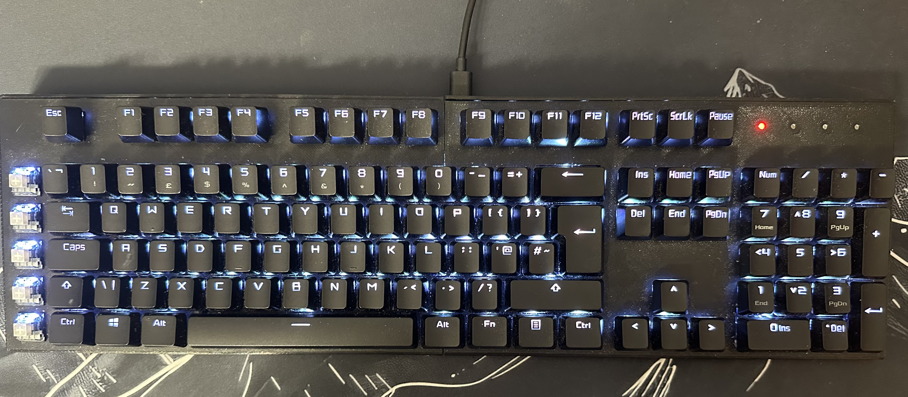
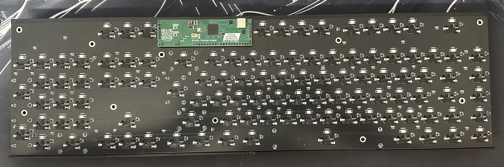
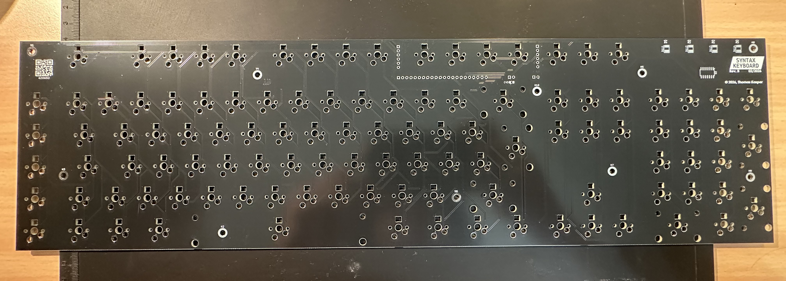
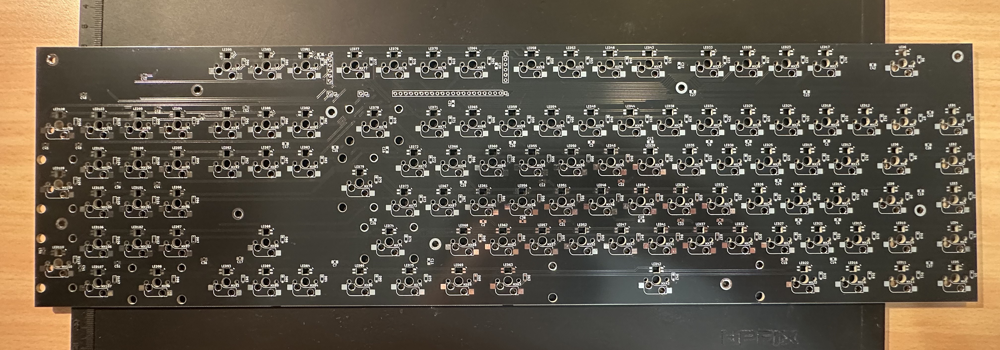
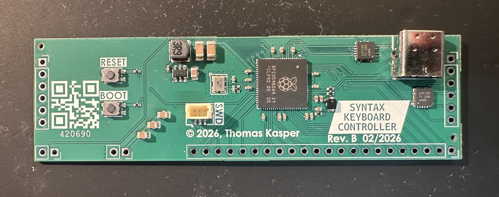

# syntaxkbd

A keyboard I made a while back.

Uses Kailh hotswap sockets with Kailh White Box V2 switches.
Standard UK QWERTY layout with 5 additional macro keys on the left (the ones where the keycaps are missing in the image below).

Also has an SK6812MINI-E addressable RGB LED for each key.

There are also four indicator LEDs (NumLock, CapsLock, ScrollLock, WinLock).
Originally, I intended to use a shift register and four discrete LEDs, but I messed up somewhere, so I bodged a WS2812B LED strip there instead.

The keycaps in the picture are from the ASUS ROG PBT Keycap Set.

The keyboard is connected via USB-C to an RP2354B microcontroller (and probably exceeds the USB standard's maximum allowed VBUS capacitance!).

The case you can see in the first image was 3D printed (PETG) in four parts.

The key placement for the PCB was done with a KiCAD extension (don't remember which one).

The keyboard is split into two PCBs: one for the keys and LEDs, and one for the controller.

Both PCBs were manufactured by JLCPCB.
I assembled the keyboard PCB (2-layer) myself, but I let JLC assemble the controller PCB (4-layer) because of the fine-pitched pins of the RP2354B.

Since the controller is an RP2354B, it can be programmed using a Raspberry Pi Debug Probe (using the SWD connector), and the firmware is written using the Raspberry Pi SDK.

I'm not quite sure what the problem is, but when I have RGB lighting effects running for a while, it starts glitching, so I usually have the LED set to static white.

Also, the firmware is not finished yet, so macros don't work yet, and lighting effects can only be reconfigured by recompiling the firmware.
It's most likely full of bugs too.
In the future, I'm also planning to have a program that can communicate with the keyboard using a vendor-specific USB interface to configure lighting effects and macros and so on.

Nonetheless, I've been using it daily for about half a year now, and it's been working great so far!
